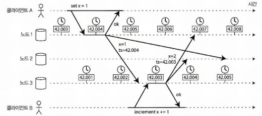
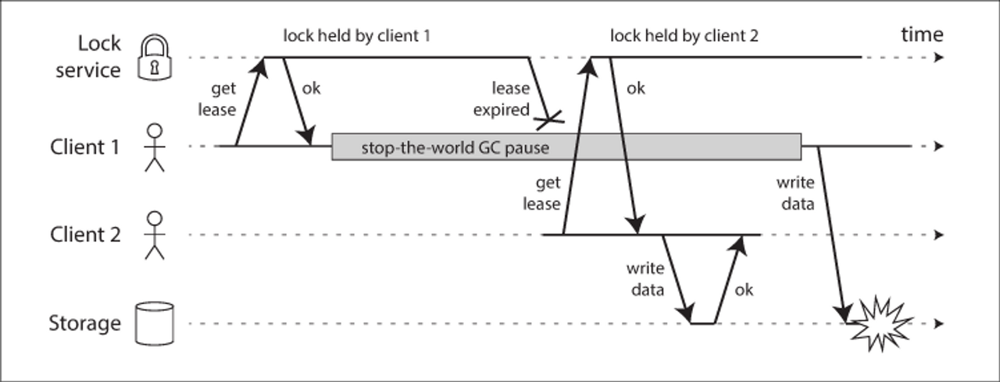
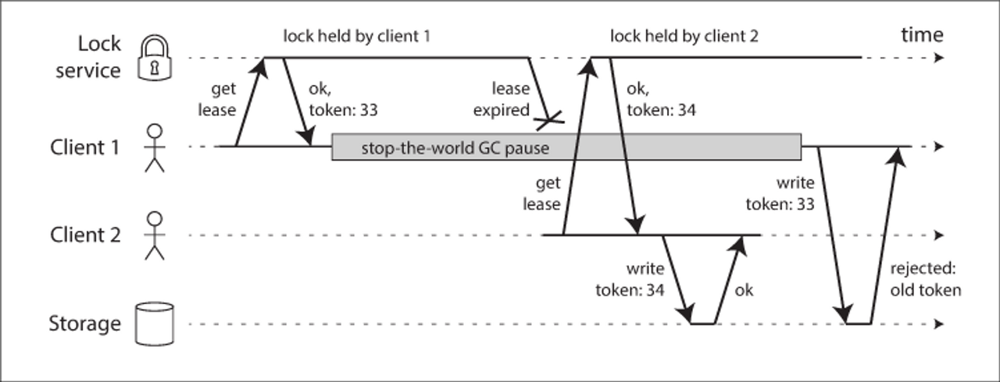

## 분산 시스템의 골칫거리

단일 시스템은 결정적  
하드웨어가 정상적으로 동작하면 같은 연산은 항상 같은 결과를 낸다.

분산 시스템은 네트워크로 통신  
네트워크는 예측할수없음  
그렇기 때문에 분산 시스템은 비결정적  
노드 또는 네트워크에서 문제가 발샐할수있어 부분 장애라고 한다.

분산 시스템을 설계할때는 부분 장애를 받아들여 일부 노드에서 장애가 발생해도 어플리케이션은 올바르게 동작할수있도록 하는 내결함성 넣어야한다

**부분 장애가 나타나는 세 가지 영역**  
네트워크  
시간  
프로세스

## 신뢰성 없는 네트워크

### 왜 신뢰성이 없나?
우리가 주로 외부 서버와 통신할 때 네트워크에 요청을 보내고 응답을 기다린다.  
그 사이에 이런 문제가 발생할 수 있다.

* 패킷이 유실됨
* 큐에서 오래 대기하다 늦게 도착함
* 상대 노드가 죽었거나 멈춰 있음
* 요청은 도착했는데 응답이 유실됨

패킷이 도착할지, 언제 도착할지 보장하지 않는 네트워크를 **비동기 패킷 네트워크**라 한다.


### 재시도와 타임아웃
응답이 없을 때 할 수 있는 건 타임아웃뿐이다.  
몇 번 재시도 후 얼마간의 시간이 지나면 응답 대기를 멈추고, 응답이 도착하지 않는다고 가정한다.

**타임아웃의 길이?**
* 너무 길면
  * 노드가 죽었다고 선언될 때까지 기다리는 시간이 길어짐
  * 그동안 사용자는 응답 지연이나 에러 화면을 보게 됨
* 너무 짧으면
  * 노드가 일시적으로 느려진 것뿐인데 죽었다고 잘못 선언됨
  * 살아 있는 노드의 작업을 다른 노드가 넘겨받아 같은 작업이 두 번 실행될 수 있음
  * 이미 부하가 높은 상황이면 부하가 다른 노드로 넘어가 연쇄 장애로 번질 수 있음

타임아웃은 정답이 없다.  
고정값 대신 응답 시간 분포를 측정해서 자동으로 조정하는 방식도 있다.

### 결론
* 타임아웃의 "죽었다"는 추측이므로 재시도해도 안전하도록 **멱등성**을 설계한다.
* 네트워크 문제는 없앨 수 없고, 있다는 전제로 설계해야 한다.


#### 비공유 시스템
분산 시스템은 네트워크로 연결되어있다.  
각각의 노드들은 독립적인 하드웨어(메모리, 디스크 등)을 가지고 있다. 이를 비공유 시스템이라 함

- 특별한 하드웨어가 필요하지 않아 상대적으로 저렴
- 상품화된 클라우드 서버를 활용
- 지리적으로 분산된 데이터센터에 중복 배치해 높은 신뢰성 확보  
  이런 이유로 분산 시스템은 비공유 시스템을 주로 사용한다.

## 신뢰성 없는 시계

애플리케이션은 요청에 응답하기 위해 시계에 의존한다.

* 요청이 타임아웃 됐는지
* 이 서비스는 지난 5분간 평균 초당 몇 개의 응답을 처리했는지
* 사용자가 이 서비스에 얼마나 있었는지
* 며칠 몇 시에 미리 알람을 보내야 하는지
* 로그로 남길 오류 메시지에 몇 시로 찍어야 하는지

앞의 세 개는 **경과 시간**, 뒤의 두 개는 **실제 시각**이 필요하다.
그래서 시계는 목적에 따라 두 종류로 나뉜다.

### 왜 신뢰성이 없나?
분산 환경에서 노드끼리 이벤트 순서를 판단하려면 서로의 시각을 비교해야 한다.
하지만 노드들은 각자 자신만의 시간 개념을 가지고 있다.

* cpu/메인보드에는 일정 주기로 진동하는 수정 발진기가 있음
* 부팅하는 순간부터 카운트가 올라간다.
* OS가 이 카운터를 읽어서 나노초 단위로 환산

### 시계의 종류
현대 컴퓨터는 최소 두 가지의 시계를 가지고 있고, 목적별로 다르게 사용된다.

**일 기준 시계 (time-of-day clock)**
* 현재 날짜와 시각을 반환하는 시계
* 부팅할 때 현재 시각을 읽고, 그 뒤로는 수정 발진기의 틱을 세서 현재 시각을 계산

```kotlin
val now = LocalDateTime.now() // 2026-10-12T16:35 같은 형태
```

**단조 시계 (monotonic clock)**
* 임의의 기준점 이후 경과 시간을 반환하는 시계
* 시각을 물어보면 OS가 수정 발진기 카운터를 반환
* 값 자체는 의미가 없고 두 값의 차이만 의미가 있다. 노드 간 비교는 불가능
* 타임아웃, 응답 시간 같은 경과 시간 측정에 사용

```kotlin
val start = System.nanoTime()
// 작업 수행
val elapsedNanos = System.nanoTime() - start  // 항상 0 이상
```

### 드리프트 (clock drift)
수정 발진기의 진동 속도가 완벽하지 않고 온도 같은 환경에 따라 미세하게 달라진다.
그래서 시간이 지날수록 실제 시간과 오차가 쌓이는데, 이를 드리프트라고 한다.
노드마다 드리프트 정도가 달라서 시간이 지나면 노드끼리 시계가 어긋난다.
두 시계 모두 같은 발진기를 쓰기 때문에 드리프트는 둘 다 발생할 수 있다.

### NTP로 보정
각 노드의 시간 오차를 줄이기 위해 시간 서버에 물어봐서 자기 시계를 맞추는 NTP(Network Time Protocol)를 사용한다.

* 시간 서버에 시각을 물어보고, 왕복 지연을 고려해 내 시계와의 차이를 계산
* 차이가 작으면 시계 속도를 조절해서 서서히 맞추고(slewing), 크면 값을 직접 고친다(step)

### NTP로 동기화한다고 해결되진 않는다
* **네트워크 지연**
  * NTP도 네트워크로 시간을 주고받기 때문에 지연이 발생한다.
  * 왕복 지연의 절반을 편도 지연으로 가정하고 보정하는데, 지연이 불규칙하면 이 가정이 깨져서 오차가 생긴다.
* **시간 점프**
  * 오차가 크면 시계 값을 직접 고치기 때문에 시간이 뒤로 갈 수 있다.
  * 일 기준 시계로 경과 시간을 재면 음수가 나올 수 있다.
* **윤초**
  * 하루가 59초나 61초가 되는 보정 때문에 시계가 이상하게 동작해서 장애가 난 사례가 있다.

NTP로 동기화해도 정확도에는 한계가 있으므로, 노드 간 시계가 정확히 맞는다고 가정하면 안 된다.

### 동기화된 시계에 의존했을 때 발생하는 문제



**LWW (Last Write Wins)**
* 같은 키에 쓰기가 충돌하면 일 기준 시계 타임스탬프가 가장 큰 쓰기를 남기는 방식
* 노드의 시계가 어긋나 있으면 실제로는 나중에 한 쓰기가 더 작은 타임스탬프를 받아 버려질 수 있다.
* 사용자에게는 쓰기가 성공했다고 응답이 가기 때문에 유실을 알아채기 어렵다.
* 실제로 동시에 일어난 쓰기인지, 순서가 있는 쓰기인지도 구분하지 못한다.

각 노드의 시간이 틀릴 수도 있다는 걸 알고 설계해야 한다.


* 경과 시간은 **단조 시계**로 잰다.
* 일 기준 시계는 대략 언제쯤인지 기록하는 용도로만 쓴다.
* 시계를 꼭 써야 하면 오차 범위를 명시적으로 다룬다. (Google Spanner는 시계의 오차 범위를 다루고 그 범위만큼 기다린다.)


## 프로세스 중단

- JVM의 STW(stop-the-world)
- 가상환경에서 서스펜드(머든 프로세스 실행을 멈추고 메모리 내용을 디스크에 저장)후 재개
- 운영체제의 컨텍스트 스위칭
- 어플리케이션가 느린 IO로 중단

실행중인 스레드가 어떤 시점에 멈추고 다시 재개될 수 있다. 이러한 현상은 동시성 문제를 일으킬 수 있다.

```
if (balance >= amount) {   // 여기서 스레드 A가 멈춤
    balance -= amount      // 그사이 스레드 B가 잔액을 바꿈. A는 깨어나서 낡은 조건으로 실행
}
```

단일 장비에선 코드를 ThreadSafe하게 만들수있는 도구들이 있다.
뮤텍스, 세마포어, atomic count, 블로킹 큐 등

하지만 분산시스템에선 이런 도구들을 사용할 수 없다. 이 도구들은 스레드들이 **같은 메모리를 공유**한다는 전제로 동작한다. 분산 시스템의 노드들은 각자 자기 메모리만 가지고 있어서 이 도구들을 그대로 쓸 수 없다.

그래서 분산 환경에서는 락을 외부(Redis, ZooKeeper)에 두고 노드들이 요청해서 쓴다.
락을 쥔 노드가 죽으면 락이 영원히 풀리지 않는다. 이를 막으려고 락에 만료 시간을 둔 것이 임차권이다. → 노드가 죽어도 시간이 지나면 다른 노드가 락을 가져갈 수 있다.

하지만 노드가 죽은 게 아니라 잠시 멈춘 경우(STW), 깨어난 노드는 락이 만료된 걸 모르고 작업을 계속할 수 있다.



이렇게 노드가 임차권을 가지고 있다고 잘못알고있는 노드가 시스템을 방해할수없도록 보장해야한다.
펜싱토큰으로 해결할수있다.

- 락 서비스가 임차권을 줄 때마다 **계속 증가하는 번호**를 준다.
- 노드는 쓰기 요청에 토큰을 붙여 보낸다.
- DB(저장소)는 **지금까지 받은 가장 큰 토큰**을 기억하고 있다가, 그보다 **작은 토큰이 오면 거부**한다.



펜싱 토큰은 안전성을 노드가 아닌 저장소에서 보장한다. 대신 저장소가 토큰을 저장하고 비교하는 책임을 가져야 한다.


### 정족수 (quorum)
네트워크에 있는 노드는 어떤 것도 확실히 알지 못한다.
네트워크로 받은 메시지, 또는 일정 시간 동안 받지 못한 상황을 근거로 추측만 할 뿐이다.

앞에서 본 STW 시나리오도 같은 문제다.
* 한 노드가 긴 STW로 1분간 멈췄다.
* 다른 노드들은 요청을 보냈지만 응답이 없어, 재시도하다 이 노드가 죽었다고 추측하고 작업을 넘긴다.
* 하지만 GC가 끝나면 멈췄던 노드는 자기가 멈췄다는 걸 모른 채 밀린 요청을 처리한다.

이렇게 다른 노드에 대한 판단도, 자기 자신에 대한 판단도 한 노드의 의견만으로는 믿을 수 없다.

그래서 분산 환경의 여러 알고리즘은 **다수결**로 결정한다. 이를 정족수라 한다.
* 노드들이 투표해서 어떤 노드가 죽었는지, 누가 리더인지를 정한다.
* 다수가 어떤 노드를 죽었다고 판단하면, 그 노드가 스스로 멀쩡하다고 느껴도 죽은 것으로 처리한다.
* 한 노드가 "내가 리더다"라고 믿어도, 다수가 인정하지 않으면 리더가 아니다.

예를 들어 노드가 5대면 3대 이상이 동의해야 결정된다.
일부 노드가 죽거나 멈춰도, 다수만 살아 있으면 시스템은 계속 결정을 내릴 수 있다.

정족수를 어떻게 구성하고 합의에 이르는지는 9장(합의)에서 다룬다.