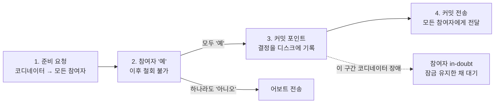

# 9장. 일관성과 합의

## 개요

분산 시스템에서 모든 노드가 하나의 사실에 동의하게 만드는 것이 합의다. 리더 선출, 유일성 제약, 원자적 커밋은 모두 합의 문제로 귀결된다.

8장이 "분산 시스템에서 무엇이 잘못될 수 있는가"를 다뤘다면, 9장은 "그럼에도 무엇을 보장할 수 있는가"를 다룬다. 장은 다음 4개 절로 구성된다.

1. **일관성 보장** — 복제본 사이에 약속할 수 있는 일관성의 수준
2. **선형성** — 가장 강한 일관성 모델. 데이터가 한 벌만 있는 것처럼 보이게 함
3. **순서화 보장** — 인과성과 전체 순서. 전체 순서 브로드캐스트가 합의와 동등한 문제임을 보임
4. **분산 트랜잭션과 합의** — 2PC의 한계, 합의 알고리즘, ZooKeeper 같은 합의 서비스

---

## 1. 일관성 보장

대부분의 복제 DB는 최종적 일관성만 보장한다. 9장은 이보다 강한 보장과 그 비용을 다룬다.

> **용어 설명 — 최종적 일관성(eventual consistency)**
> 쓰기를 멈추고 기다리면 언젠가 모든 복제본이 같은 값으로 수렴한다는 보장. "언제"는 약속하지 않음. 수렴(convergence)이라고도 함.

- 최종적 일관성은 매우 약한 보장임. 방금 쓴 값을 바로 읽어도 옛 값이 나올 수 있음
- 문제는 평소에는 드러나지 않고 장애나 높은 동시성 상황에서 드러남. 테스트로 잡기 어려움
- 강한 일관성 모델은 사용하기 쉬우나 성능과 내결함성을 희생함

7장의 격리 수준과 혼동하기 쉬우나 관심사가 다르다.

| 구분 | 트랜잭션 격리 (7장) | 분산 일관성 (9장) |
| --- | --- | --- |
| 관심사 | 동시에 실행되는 트랜잭션 간 경쟁 조건 | 지연과 결함 속에서 복제본 상태 조정 |
| 대표 모델 | 직렬성, 스냅숏 격리 | 선형성, 인과적 일관성 |

---

## 2. 선형성 (Linearizability)

선형성은 복제본이 여러 개여도 데이터가 하나만 있는 것처럼 보이게 하는 보장이다. 최신성 보장(recency guarantee), 원자적 일관성, 강한 일관성이라고도 한다.

### 책의 예시: 월드컵 점수

1. 앨리스가 새로고침하여 "경기 종료" 결과를 확인함
2. 앨리스가 밥에게 결과를 알려 줌
3. 그 뒤에 밥이 새로고침했으나 "경기 진행 중"이 보임

밥의 요청은 앨리스보다 늦게 들어갔으나 더 오래된 값을 받았다. 이는 선형성 위반이다.

### 핵심 규칙

> **용어 설명 — 레지스터(register)**
> CPU 레지스터가 아니라 값 하나를 읽고 쓸 수 있는 객체 하나를 의미함. 키-값 저장소의 키 하나, 테이블의 행 하나에 해당함.

- 쓰기가 완료되면 그 이후 시작한 모든 읽기는 새 값을 반환해야 함
- 한 번이라도 새 값을 반환한 읽기가 있으면, 그 이후의 모든 읽기는 옛 값을 반환하면 안 됨
- 각 연산은 시작과 완료 사이의 한 시점에 원자적으로 실행된 것처럼 보여야 하며, 그 시점들은 실제 시간 순서를 따라야 함

### 선형성이 필요한 곳

| 상황 | 필요한 이유 |
| --- | --- |
| 리더 선출, 잠금 | 모든 노드가 잠금 소유자에 동의해야 함. 그렇지 않으면 리더가 둘이 됨(스플릿 브레인) |
| 유일성 제약 | 같은 사용자명, 같은 좌석을 두 명이 동시에 점유하면 안 됨 |
| 채널 간 타이밍 의존성 | 이미지 업로드 후 메시지 큐로 리사이즈 요청을 보냈을 때, 리사이저가 저장소에서 옛 이미지를 읽을 수 있음 |

### 복제 방식별 선형성

| 복제 방식 (5장) | 선형성 |
| --- | --- |
| 단일 리더 | 잠재적으로 가능. 리더나 동기 팔로워에서 읽어야 하며, 자신을 리더로 착각하는 노드가 없어야 함 |
| 합의 알고리즘 | 가능. ZooKeeper, etcd가 해당함 |
| 다중 리더 | 불가능. 여러 노드에서 동시에 쓰고 비동기로 복제하기 때문 |
| 리더 없음 (다이나모 스타일) | 아마도 불가능. 정족수(w + r > n)를 지켜도 네트워크 지연에 따라 위반될 수 있음. 최종 쓰기 승리(LWW)는 확실히 불가능 |

### 비용: CAP 정리

> **용어 설명 — CAP**
> 일관성(Consistency), 가용성(Availability), 분단 내성(Partition tolerance)의 약자. 여기서 C는 선형성을 의미함.

- 네트워크 분단은 선택 사항이 아니라 언젠가 발생하는 결함임. 따라서 CAP는 분단 발생 시 일관성과 가용성 중 무엇을 포기할지의 문제임
- 선형성을 택하면 분단된 쪽 복제본은 요청을 처리하지 못하고 대기하거나 오류를 반환해야 함
- 책은 CAP의 실용적 가치가 크지 않다고 평가함. 네트워크 분단 하나만 고려하고 지연이나 노드 장애는 다루지 않기 때문
- 선형성을 포기하는 더 흔한 이유는 성능임. 멀티코어 CPU의 RAM조차 캐시 때문에 선형적이지 않음. 선형성을 보장하면 응답 시간이 네트워크 지연의 불확실성에 비례해 늘어남

---

## 3. 선형성 vs 직렬성

두 개념은 이름이 비슷하나 보장하는 대상이 다르다. 직렬성은 동시 실행된 트랜잭션이 섞이지 않음을, 선형성은 읽기가 최신 값을 반환함을 보장한다.

| 구분 | 직렬성 (Serializability) | 선형성 (Linearizability) |
| --- | --- | --- |
| 대상 | 트랜잭션 (여러 객체의 읽기·쓰기 묶음) | 단일 객체 (레지스터, 키 하나) |
| 보장 내용 | 동시 실행 결과가 어떤 직렬 실행 결과와 같음 | 읽기가 가장 최신 값을 반환함 |
| 시간 순서 | 임의의 순서여도 무방 | 실제 시간 순서를 따라야 함 |
| 책에서의 위치 | 7장, 격리 (ACID의 I) | 9장, 복제 일관성 (CAP의 C) |

- 직렬성은 은행 창구에 비유할 수 있음. 거래 처리 순서는 은행이 임의로 정해도 되나, 거래끼리 섞여 잔고가 어긋나면 안 됨
- 선형성은 경기장 전광판에 비유할 수 있음. 바뀐 점수를 본 사람이 있으면, 그 이후 보는 사람은 옛 점수를 보면 안 됨

### 직렬성 O, 선형성 X

1. 리더에서 x=2로 변경하는 트랜잭션 T1이 커밋됨
2. 그 이후 시작한 읽기 전용 트랜잭션 T2가 복제 지연된 팔로워에서 x=1을 읽음
3. "T2 → T1" 순서의 직렬 실행으로 설명 가능하므로 직렬성은 만족함
4. 실제 시간상 T1이 먼저 완료되었으므로 선형성은 위반임

책은 SSI(Serializable Snapshot Isolation, 직렬성 스냅숏 격리)가 선형적이지 않다고 설명한다. 일관된 스냅숏에서 읽으므로 스냅숏 이후의 쓰기를 볼 수 없기 때문이다.

### 선형성 O, 직렬성 X

- 7장의 당직 의사 예시(쓰기 스큐)가 대표적임
- 각 키에 대한 읽기·쓰기는 최신 값을 반환하므로 선형성은 만족함
- 두 트랜잭션이 각자 "다른 의사가 있으므로 빠져도 된다"고 판단하여 당직이 0명이 됨. 직렬성 위반임
- 선형성은 단일 객체에 대한 보장이므로 여러 객체에 걸친 쓰기 스큐를 막지 못함

### 둘 다 만족하는 경우

- 엄격한 직렬성(strict serializability) 또는 강한 단일 복사본 직렬성(strong-1SR)이라고 함
- 2PL(Two-Phase Locking, 2단계 잠금)이나 실제 직렬 실행으로 구현한 직렬성은 일반적으로 선형성도 만족함

---

## 4. 순서화 보장

인과성은 선형성보다 약하지만 대부분의 경우 충분한 보장이다. 전체 순서 브로드캐스트는 합의와 동등한 문제이므로, 이 절은 다음 절의 합의로 이어진다.

### 인과성과 전체 순서

> **용어 설명 — 인과성(causality)**
> "질문이 답변보다 먼저", "행 생성이 수정보다 먼저"와 같은 원인과 결과의 순서. 인과적으로 관련 없는 두 연산은 동시적(concurrent)이라고 함.

| 구분 | 전체 순서 (선형성) | 부분 순서 (인과성) |
| --- | --- | --- |
| 비교 가능성 | 모든 두 연산의 선후 비교 가능 | 동시적 연산끼리는 비교 불가 |
| 타임라인 형태 | 하나의 직선 | 분기와 병합이 있는 형태 (Git 히스토리와 유사) |
| 관계 | 선형성은 인과성을 함의함 | 인과적 일관성은 네트워크 지연 상황에서도 가용성을 유지하는 가장 강한 모델임 |

### 일련번호와 램포트 타임스탬프

연산마다 번호를 부여하여 인과성을 추적할 수 있다.

- **단일 리더**: 리더가 카운터를 증가시키면 됨. 복제 로그 순서가 곧 전체 순서임
- **리더가 없는 경우**: 노드별 카운터, 물리 시계, 번호 블록 사전 할당 등의 방법이 있으나 모두 인과성과 일치하지 않음
- **램포트 타임스탬프**: (카운터, 노드 ID) 쌍. 노드는 수신한 요청의 최대 카운터보다 크게 자신의 카운터를 증가시킴. 이를 통해 인과성과 일치하는 전체 순서를 생성함

### 타임스탬프 순서만으로 부족한 이유

- 사용자명 유일성 제약을 예로 듦. 두 노드가 같은 사용자명으로 가입 요청을 받은 상황
- 램포트 타임스탬프로 사후에 선후 관계를 판단할 수 있음
- 그러나 요청을 받은 시점에는 다른 노드가 더 작은 타임스탬프로 같은 이름을 처리 중인지 알 수 없음. 모든 노드에 확인해야 하며, 한 노드라도 응답하지 않으면 진행 불가
- 즉, 순서가 언제 확정되는지까지 알아야 함. 이것이 전체 순서 브로드캐스트가 필요한 이유임

### 전체 순서 브로드캐스트 (Total Order Broadcast)

노드 간 메시지 교환 프로토콜로, 다음 두 속성을 항상 만족해야 한다.

1. **신뢰성 있는 전달**: 한 노드에 전달된 메시지는 모든 노드에 전달됨
2. **전체 순서 전달**: 모든 노드에 같은 순서로 전달됨

- DB 복제 로그와 동일한 개념임. 모든 복제본이 같은 쓰기를 같은 순서로 처리하면 일관된 상태가 됨(상태 기계 복제)
- 순서는 메시지 전달 시점에 고정됨. 이미 전달된 메시지 앞에 새 메시지를 삽입할 수 없음
- 전체 순서 브로드캐스트로 선형적 저장소를 구현할 수 있고, 그 역도 성립함
- 두 문제 모두 합의와 동등함이 증명되어 있음

---

## 5. 분산 트랜잭션과 합의

합의는 여러 노드가 하나의 값에 동의하게 만드는 것이다. 2PC도 일종의 합의이나 코디네이터 장애 시 멈추므로, 내결함성을 갖춘 합의 알고리즘이 별도로 필요하다.

### 합의가 필요한 곳

- **리더 선출**: 리더가 둘이 되면(스플릿 브레인) 데이터 불일치 발생
- **원자적 커밋**: 여러 노드에 걸친 트랜잭션이 모두 커밋되거나 모두 어보트되어야 함
- **유일성 제약, 잠금**: 선형성 절에서 다룬 문제

> **용어 설명 — FLP 불가능성**
> 노드가 죽을 수 있는 비동기 시스템에서는 항상 합의에 도달하는 알고리즘이 존재하지 않는다는 증명. 단, 타임아웃이나 난수를 사용하면 현실에서는 합의가 가능함.

### 2PC (Two-Phase Commit, 2단계 커밋)

여러 노드에 걸친 트랜잭션을 원자적으로 커밋하는 알고리즘이다. 코디네이터(트랜잭션 관리자)가 진행한다.

1. **준비 단계**: 코디네이터가 모든 참여자에게 커밋 가능 여부를 질의함
2. 참여자가 "예"라고 응답하면, 그 시점부터 어떤 상황에서도 커밋할 수 있음을 약속한 것임. 철회 불가
3. **커밋 단계**: 모두 "예"이면 코디네이터가 커밋 결정을 디스크에 기록(커밋 포인트)하고 모든 참여자에게 커밋을 전송함. 하나라도 "아니오"이면 어보트를 전송함

2PC에는 돌아갈 수 없는 지점이 두 곳 있다. 참여자의 "예" 응답과 코디네이터의 결정 기록이다.

### 2PC의 약점: 코디네이터 장애

- 참여자가 "예"라고 응답한 뒤 코디네이터가 죽으면 참여자는 의심스러운(in-doubt) 상태가 됨
- 참여자는 단독으로 커밋도 어보트도 할 수 없음. 코디네이터 복구까지 잠금을 유지한 채 대기해야 함
- 그동안 해당 행에 접근하는 다른 트랜잭션도 모두 차단됨. 코디네이터 로그가 유실되면 관리자가 수동으로 결정해야 함
- 이 때문에 2PC는 블로킹 원자적 커밋 프로토콜이라고 불림

### 현실의 분산 트랜잭션

| 종류 | 설명 |
| --- | --- |
| DB 내부 분산 트랜잭션 | 같은 DB의 노드 간에 진행. 예: VoltDB, MySQL 클러스터의 NDB. 비교적 잘 동작함 |
| 이종 분산 트랜잭션 | 서로 다른 기술(DB + 메시지 브로커 등) 간에 진행. XA가 표준임 |

> **용어 설명 — XA (eXtended Architecture)**
> 이종 시스템 간 2PC를 위한 C API 표준. 자바에서는 JTA(Java Transaction API)로 구현됨. 코디네이터는 보통 애플리케이션 프로세스 내의 라이브러리임.

- 코디네이터가 애플리케이션 서버 내부에 있으므로 해당 서버가 단일 장애점이 됨. 상태 없는(stateless) 서버라도 코디네이터 로그로 인해 상태를 갖게 됨
- XA는 여러 시스템의 최소 공통 기능만 지원하므로 교착 상태 감지, SSI 등의 기능을 사용할 수 없음

### 내결함성 합의 알고리즘

합의 알고리즘은 다음 속성을 만족해야 한다.

| 속성 | 의미 |
| --- | --- |
| 균일한 동의 | 어떤 두 노드도 다르게 결정하지 않음 |
| 무결성 | 어떤 노드도 두 번 결정하지 않음 |
| 유효성 | 결정된 값은 어떤 노드가 제안한 값임 |
| 종료 | 죽지 않은 노드는 결국 결정함 (내결함성의 핵심) |

- 대표 알고리즘: VSR, Paxos, Raft, Zab. 모두 전체 순서 브로드캐스트를 구현함
- **에포크 번호**: 리더가 죽은 것으로 판단되면 새 에포크 번호로 투표하여 새 리더를 선출함. 에포크 번호가 높은 리더가 우선함(Raft의 term, Zab의 epoch)
- 리더는 결정 전에 정족수(과반수)의 투표를 받아야 함. 선출 정족수와 제안 정족수가 반드시 겹치므로 더 높은 에포크의 존재 여부를 확인할 수 있음
- 2PC는 모든 참여자의 "예"가 필요하나, 합의 알고리즘은 과반수만 필요함. 따라서 일부 노드 장애에도 진행 가능함

### 합의의 비용

- 결정 전 투표 과정은 동기 복제와 같아 성능이 낮음
- 과반수가 필요하므로 장애 f개를 견디려면 최소 2f + 1개 노드가 필요함 (3대는 1대, 5대는 2대까지 허용)
- 대부분 노드 집합이 고정되어 있어 클러스터 멤버십 변경이 어려움
- 장애 감지를 타임아웃에 의존하므로, 네트워크가 불안정하면 리더 선출이 빈번해져 성능이 저하됨

---

## 6. ZooKeeper: 합의의 외부 위임

책은 ZooKeeper를 범용 DB가 아닌, 합의를 대신 처리하는 서비스로 소개한다. 애플리케이션이 합의 알고리즘을 직접 구현하지 않고, 3~5대의 ZooKeeper에 위임하여 수천 대의 노드를 조율하는 구조다.

- 데이터 규모가 작아 메모리에 모두 적재 가능함. 자주 변경되지 않는 설정·메타데이터 용도임
- 내부적으로 Zab 합의 알고리즘으로 전체 순서 브로드캐스트를 구현함
- etcd도 같은 범주에 속함(Raft 기반)

### 주요 기능

| 기능 | 내용 | 9장 개념과의 연결 |
| --- | --- | --- |
| 선형적 원자적 연산 | CAS(Compare-And-Set)로 잠금 구현 | 선형성 |
| 연산의 전체 순서 | 모든 연산에 단조 증가하는 zxid 부여 | 8장의 펜싱 토큰으로 활용 |
| 장애 감지 | 세션 하트비트가 끊기면 해당 세션의 임시 노드(ephemeral node)가 자동 삭제됨 | 죽은 노드의 잠금 자동 해제 |
| 변경 알림 | watch로 다른 노드의 변경을 구독 | 폴링 없이 리더 변경 감지 |

> **용어 설명 — 펜싱 토큰(fencing token)**
> 잠금 획득 시마다 발급되는 증가하는 번호. 저장소는 이미 처리한 번호보다 작은 토큰을 가진 요청을 거부함. GC 멈춤 등으로 잠금이 만료된 클라이언트의 지연된 쓰기를 차단함(8장).

### 주요 사용처

- **리더 선출**: 리더가 죽으면 임시 노드가 삭제되고, watch를 통해 다른 노드가 이를 감지함
- **작업 할당**: 파티션의 노드 배치를 결정함. 6장의 재균형과 연결됨. 예: HBase, Kafka(구버전), Solr
- **서비스 디스커버리, 멤버십 관리**: 활성 노드 목록 관리. 책은 서비스 디스커버리 자체는 반드시 합의가 필요하지는 않다고 언급함

### 주의: 읽기는 기본적으로 선형적이지 않음

- 쓰기는 리더를 경유하므로 선형적임
- 읽기는 클라이언트가 연결된 임의의 노드에서 처리되므로 옛 값을 반환할 수 있음
- 선형적 읽기가 필요하면 읽기 전에 `sync()`를 호출해야 함
- 3절의 "팔로워에서 옛 값 읽기" 예시가 그대로 적용되는 사례임

### 운영 관점

- 과반수가 필요하므로 3대는 1대, 5대는 2대까지 장애를 허용함
- Kafka는 ZooKeeper 의존성을 제거하고 내장 합의(KRaft, Raft 기반)로 전환함. 합의를 외부 서비스에 위임할지 내장할지의 트레이드오프를 보여 주는 사례임

---

## 7. 핵심 요약

- **선형성**: 데이터가 한 벌인 것처럼 최신 값을 보장함. 성능이 낮고 분단 시 가용성을 잃음
- **직렬성**: 트랜잭션 간 간섭이 없음을 보장함. 실제 시간 순서와 무관함
- **인과성**: 선형성보다 약하나 가용성을 유지할 수 있는 가장 강한 모델임
- **전체 순서 브로드캐스트 = 선형적 CAS = 합의**: 모두 동등한 문제임
- **2PC**: 원자적 커밋을 보장하나 코디네이터 장애 시 블로킹됨
- **합의 알고리즘**: 과반수 기반으로 진행하므로 일부 장애를 견딤
- **ZooKeeper**: 합의를 직접 구현하지 않고 외부 서비스에 위임하는 방식임
