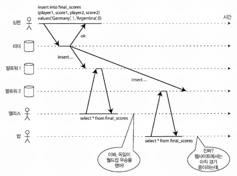
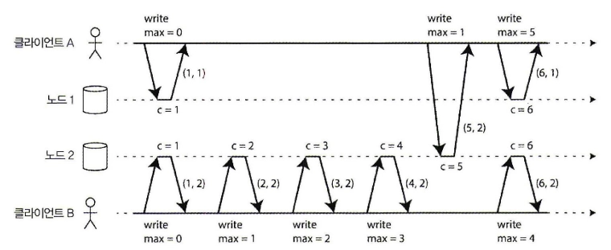
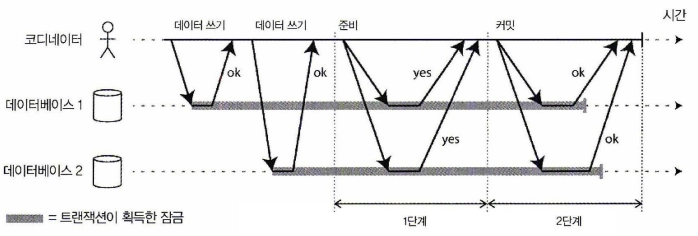
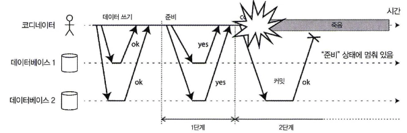

## 개요
8장에선 분산환경에서 노드 간 발생할 수 있는 문제를 알아봤다.

- **네트워크**: 요청에 응답이 없을 때, 상대 노드가 죽은 건지 / 메시지가 유실된 건지 / 그냥 느린 건지 구분할 수 없다.
- **시계**: 노드마다 시계가 조금씩 다르고 동기화도 완벽하지 않다.
- **프로세스**: GC 등으로 프로세스가 예고 없이 멈췄다가 다시 깨어날 수 있다.

이 문제들 때문에 노드마다 보는 데이터와 연산의 순서가 달라진다. 복제가 늦게 도착한 노드는 옛날 값을 보고, 네트워크 지연 때문에 같은 연산들이 노드마다 다른 순서로 도착하고, 시계로는 무엇이 먼저인지 정확히 판단할 수 없다.

그래서 여러 노드가 있을 때 **어떤 상태와 순서를 보장할 것인가**를 정해야 하고, 이게 일관성이다.

--- 

## 분산환경에서 일관성이란

**복제된 여러 노드에서 데이터가 어떤 순서와 시점으로 보이는지**에 대한 보장이다.

> **참고: ACID의 일관성과는 다르다**
> ACID의 일관성은 트랜잭션 전후로 DB가 애플리케이션이 정한 **불변식**(잔고는 음수가 될 수 없다, 외래키가 가리키는 행은 존재해야 한다 등)을 만족하는 상태를 유지하는 것이다.

여러 일관성 모델들이 있다.
- 최종적 일관성
- 선형성
- 인과적 일관성

최종적 일관성은 쓰기를 멈추고 일정 시간이 지나면 결국엔 모든 요청이 같은 값을 반환하게 된다는 것이다.
복제DB는 대부분 최종적 일관성을 제공한다.

하지만 언제 모든 노드들이 같은 값을 주는지에 대해서는 모른다. 또한 모든 복제가 끝나기 전까지는 같은 값을 보장할 수 없다. 최종적 일관성은 약한 보장 일관성 모델이다.

### 선형성

선형성은 강한 일관성 모델로 복사본이 여러 개여도 데이터가 **하나뿐인 것처럼** 동작하는 보장
- 쓰기가 끝나면, 이후의 모든 읽기는 그 값 또는 더 최신 값을 읽는다
- 쓰기가 진행 중이어도, 누군가 새 값을 **한 번이라도 읽었다면** 그 이후의 모든 읽기(다른 클라이언트 포함)는 새 값 이상이어야 한다

월드컵 결승이 끝나고 최종 스코어가 리더에 기록됐다. 팔로워로 복제되는 중이다.

1. 앨리스가 새로고침 → 복제가 끝난 팔로워에서 읽음 → 최종 스코어 확인
2. 앨리스가 옆의 밥에게 "경기 끝났어"라고 말함
3. 밥이 새로고침 → 복제가 덜 된 팔로워에서 읽음 → "경기 진행 중"

밥은 앨리스보다 **나중에** 요청했는데 **옛날 값**을 봤다. 선형성 위반이다.

**복제 방식별 선형성**

| 복제 방식   | 선형성         | 이유                   |
| ------- | ----------- | -------------------- |
| 단일 리더   | 리더에서 읽으면 가능 | 팔로워 읽기는 복제 지연으로 깨짐   |
| 합의 알고리즘 | 가능          | 뒤에서 다룸               |
| 다중 리더   | 불가          | 여러 노드가 동시에 쓰고 비동기 복제 |

**선형성의 비용**

선형성을 보장하려면 여러 노드가 동일한 데이터와 연산 순서를 유지하는지 확인해야한다.
이 과정에서 네트워크 통신과 노드 간 조정이 추가되고, 네트워크 지연이나 장애가 발생하면 응답도 늦어진다.
따라서 많은 DB가 선형성을 기본으로 제공하지 않는다.

## 인과적 일관성

**원인과 결과의 순서**만 보장하는 것.

- 질문이 있어야 답변이 보인다
- 글이 있어야 댓글이 보인다
- 상품이 있어야 주문이 된다.

선형성은 매우 강한 일관성으로, 모든 연산이 한 줄로 세워지고 모든 노드가 그 한 줄을 똑같이 바라보게 한다. 그렇기 때문에 노드 간 조정이 많이 필요해서 느리고, 네트워크가 끊기면 일부 노드가 멈춘다.

하지만 인과적 일관성은 원인과 결과가 있는 것만 순서를 지키게끔 보장하고, 관계없는 연산은 노드마다 다른 순서로 보여도 상관없다. 그래서 더 빠르고, 네트워크가 끊겨도 동작한다.

인과적 일관성을 지키려면 노드들이 "**무엇이 무엇보다 먼저 일어났는지**"를 알아야 한다. 그런데 시계는 믿을 수 없다. 여러 노드에서 순서를 어떻게 맞출까?

--- 

### 일련번호로 순서 매기기
인과 관계를 하나하나 추적하는 건 비싸다. 대신 이벤트마다 **번호**를 붙여 순서를 매긴다.

#### 램포트 타임스탬프

일련번호를 생성하는 간단한 방법으로 램포트 타임스탬프가 있다.
(카운터, 노드ID)의 쌍이다.

각 노드는 고유 식별자를 갖고 각 노드는 처리한 연산 개수를 카운터로 유지한다.
카운터 값이 같을 수 있지만 타임스탬프에 노드ID를 포함시켜 중복되지 않게 한다.

### 타임스탬프 순서의 한계

예를 들어 사용자명으로 사용자 계정을 유일하게 식별할 수 있도록 보장해야 하는 시스템을 고려해보자. 두 사용자가 동시에 동일한 사용자명으로 계정을 생성하려고 하면 둘 중 한 명은 성공하고 다른 사람은 실패해야 한다 .

램포트 타임스탬프로 해결하는 과정
- 더 작은 번호의 요청이 다른 노드에 없는지를 확인
- 모든 노드에 물어봐야 함
- 한 노드라도 응답이 없으면, 그 노드에 더 작은 번호의 요청이 있을 수도 있으니 **결정을 못 내림**
- 그 노드가 영원히 죽어 있으면 영원히 대기

노드가 사용자로부터 사용자명 생성 요청을 막 받고 그 요청의 성공 혹은 실패 여부를 당장 결정해야 할 때는 램포트 타임스탬프로는 부족하다.

## 전체 순서 브로드캐스트

노드 사이에 메시지를 교환하는 프토토콜로 두 가지를 보장한다.

- **신뢰성 있는 전달**: 한 노드에 전달된 메시지는 모든 노드에 전달된다 (유실 없음)
- **전체 순서가 정해진 전달**: 모든 노드가 메시지를 **같은 순서로** 받는다

전체 순서 브로드캐스트는 어떻게 구현할까? "다음에 전달할 메시지는 이것"이라는 데 **모든 노드가 동의**해야 한다. 이게 바로 합의다.

# 노드들이 동일한 결정에 도달하려면?

## 합의란 무엇인가?

**합의**: 여러 노드가 **하나의 값에 동의**하는 것.

앞에서 나온 문제들이 모두 합의 문제다.

- **리더 선출**: 누가 리더인지 모든 노드가 동의해야 한다
- **유일성**: 이 사용자명이 누구 것인지 동의해야 한다
- **전체 순서 브로드캐스트**: 다음에 전달할 메시지가 무엇인지 동의해야 한다
- **원자적 커밋**: 여러 노드에 걸친 트랜잭션을 커밋할지 중단할지 동의해야 한다

**전체 순서 브로드캐스트와 합의**

전체 순서 브로드캐스트는 "모든 노드가 같은 순서로 받는다"는 **결과**에 초점을 둔 이름이고, 합의는 "모든 노드가 같은 값에 동의한다"는 **과정**에 초점을 둔 이름이다.

"다음 순번에 올 메시지는 무엇인가"에 합의하는 걸 메시지마다 반복하면 그게 곧 전체 순서 브로드캐스트다. 그래서 책에서는 둘을 **동치**라고 한다.

## 합의가 만족해야 하는 조건

|   |   |
|---|---|
|조건|의미|
|균일한 동의|두 노드가 서로 다른 결정을 내리지 않는다|
|무결성|한 번 결정하면 바꾸지 않는다|
|유효성|결정된 값은 어떤 노드가 실제로 제안한 값이다|
|종료|죽지 않은 노드는 결국 결정을 내린다|

종료 조건은 노드 일부가 죽어도 멈추지 않고 결정을 내려야 한다는 뜻이다. 이 때문에 합의는 **과반수의 노드만 살아 있으면** 진행할 수 있어야 한다.

---

그럼 합의는 실제로 어떻게 구현할까?

# 합의를 구현하는 방법

## 2PC (2단계 커밋)

여러 노드에 걸친 트랜잭션을 전부 커밋하거나 전부 중단하는 **원자적 커밋** 프로토콜. **코디네이터**가 하나 있다.

1. **준비(prepare)**: 코디네이터가 모든 참여자에게 "커밋할 수 있어?"라고 묻는다
2. 참여자는 커밋 가능하면 "예"라고 답한다. 이 "예"는 **나중에 무조건 커밋하겠다는 약속**이라 혼자 취소할 수 없다
3. **커밋(commit)**: 모두 "예"면 코디네이터가 결정을 디스크에 기록하고 모두에게 커밋을 지시한다. 하나라도 "아니오"면 전부 중단

**코디네이터 장애**

참여자가 "예"라고 답한 뒤 코디네이터가 죽으면:

- 참여자는 커밋할지 중단할지 **스스로 결정할 수 없다** (in-doubt)
- 그동안 관련 행의 **락을 잡은 채 대기**한다 → 다른 트랜잭션까지 막힌다
- 코디네이터가 복구될 때까지 기다리는 수밖에 없다

그래서 MSA에서는 여러 서비스를 2PC(XA)로 묶는 걸 피하고, Saga(실패 시 보상 트랜잭션)나 트랜잭셔널 아웃박스를 쓴다.

**2PC는 합의로 부족하다**

2PC도 모든 노드가 같은 결론(커밋/중단)을 내리게 해준다. 하지만 코디네이터가 고정되어 있어서, 코디네이터가 죽으면 영원히 기다릴 수 있다. 합의 조건 중 **종료**를 만족하지 못한다.

## 과반수 기반 합의

장애를 견디는 합의는 코디네이터처럼 고정된 노드에 의존하지 않고, **과반수의 동의**로 결정한다. 대표적인 알고리즘이 Raft다.

**노드 5대 (리더 1, 팔로워 4)**

1. 모든 요청은 **리더한테만** 보냄
2. 리더가 받은 순서대로 로그에 번호를 붙임
    - 1번: A 요청
    - 2번: B 요청
3. 리더가 이 로그를 팔로워들한테 복제
4. **과반수(5대 중 3대)** 가 저장했다고 응답하면 그 번호는 **확정**
5. 확정된 순서대로 모든 노드가 처리 → 1번 A가 이김, 2번 B는 실패

이 로그 복제가 곧 **전체 순서 브로드캐스트**다.

**리더가 죽으면**

1. 팔로워가 일정 시간 리더 소식이 없으면 후보가 되어 투표를 요청한다
2. 과반수 표를 받으면 새 리더가 되고, **임기(term) 번호**를 1 올린다
3. 옛 리더가 GC로 멈췄다 깨어나서 자기가 리더인 줄 알고 요청을 보내도, 임기 번호가 낮아서 다른 노드들이 무시한다 (8장 펜싱 토큰과 같은 원리)

**왜 과반수인가**

과반수끼리는 **반드시 한 노드 이상 겹친다.** 5대 중 3대와 다른 3대는 최소 1대가 겹친다. 그래서 리더가 동시에 둘 뽑히거나, 같은 순번에 다른 요청이 확정되는 일이 없다.

**합의의 비용**

- 매 결정마다 과반수와 통신해야 해서 느리다
- 과반수가 살아 있어야 한다. 네트워크가 갈라지면 소수 쪽은 멈춘다

그래서 애플리케이션이 합의를 직접 구현하지는 않고, **ZooKeeper, etcd** 같은 서비스에 맡긴다. Kafka도 컨트롤러 선출과 메타데이터 관리를 KRaft(Raft 기반)로 처리한다.