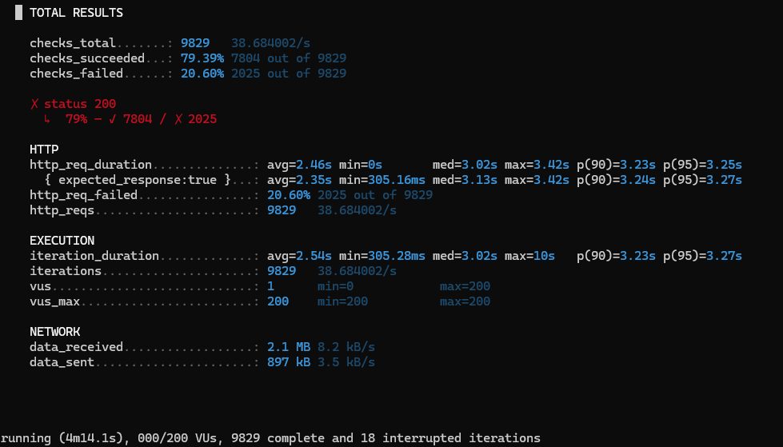
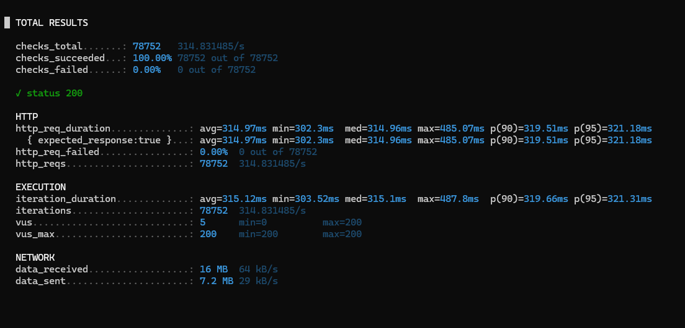
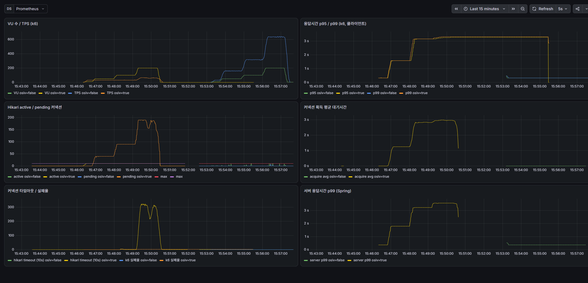
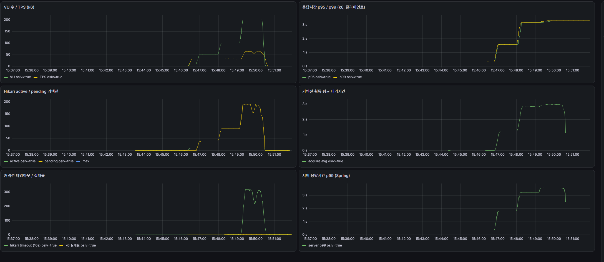

# OSIV on/off에 따른 커넥션 풀 고갈 실험

> 『자바 ORM 표준 JPA 프로그래밍』 13장(웹 애플리케이션과 영속성 관리)의 OSIV 개념을 부하 테스트로 직접 검증한 실험
>
> 실험일: 2026-11-12

---

## 1. 배경

- 스프링 OSIV는 영속성 컨텍스트를 **요청이 끝날 때까지** 유지한다.
- 영속성 컨텍스트가 살아 있는 동안 **DB 커넥션도 함께 점유**한다.
- 따라서 컨트롤러에 느린 작업(외부 API 호출 등)이 있으면, 트랜잭션이 끝난 뒤에도 커넥션이 풀에 반납되지 않는다.

Spring Boot는 `spring.jpa.open-in-view` 기본값이 `true`이므로, 이 영향을 수치로 확인해 본다.

## 2. 가설

OSIV를 켜면 서비스 트랜잭션이 끝난 뒤에도 응답이 나갈 때까지 커넥션을 점유한다. 그래서 컨트롤러에 느린 작업이 있으면 커넥션 풀이 먼저 고갈되고, 처리량이 크게 떨어진다.

**사전 계산** (커넥션 풀 10개, 컨트롤러 지연 300ms)

- OSIV on: 요청 하나가 커넥션을 약 300ms 점유 → 최대 10 ÷ 0.3 ≈ **33 TPS**
- OSIV off: 커넥션은 쿼리 몇 ms 동안만 점유 → 커넥션 풀이 병목이 되지 않음

## 3. 실험 환경

| 구성요소 | 역할 |
|---|---|
| Spring Boot 3.5 / Java 21 | 측정 대상 애플리케이션 (로컬 실행) |
| PostgreSQL 16 | DB (Docker) |
| k6 | 부하 생성, 결과를 Prometheus로 전송 (Docker) |
| Prometheus | 메트릭 수집, 1초 주기 (Docker) |
| Grafana | 대시보드 시각화 (Docker) |

```
k6 ──(부하)──▶ Spring Boot 앱 ◀──(1초마다 수집)── Prometheus ◀──(조회)── Grafana
```

## 4. 실험 설계

### 도메인

- `Order` → `Member` (`@ManyToOne(fetch = LAZY)`)
- 회원 1,000명, 주문 10,000건 적재
  - 앱이 켜질 때 딱 한 번, `DataInitializer`가 DB에 미리 넣어 두는 테스트 데이터다.
  - 부하 테스트를 시작하기 전에 이미 끝나 있다.
  - 조회할 대상이 있어야 하므로 미리 깔아 둔 것이다.
  - 부하 테스트 중에는 데이터를 저장하지 않고 **조회만** 한다.

### API: `GET /orders/{id}`

```java
// Service: 트랜잭션 안에서 DTO 변환까지 끝냄
@Transactional(readOnly = true)
public OrderDto findOrder(Long id) {
    return orderRepository.findById(id)
            .map(OrderDto::from)   // member 지연 로딩 포함
            .orElseThrow();
}

// Controller
@GetMapping("/orders/{id}")
public OrderDto get(@PathVariable Long id) throws InterruptedException {
    OrderDto dto = orderService.findOrder(id); // 트랜잭션 종료
    Thread.sleep(300);                         // 외부 API 호출 흉내
    return dto;
}
```

**통제 변수:** DTO 변환을 서비스 트랜잭션 안에서 끝내기 때문에, OSIV off여도 `LazyInitializationException`이 발생하지 않는다. 따라서 코드는 그대로 두고 `spring.jpa.open-in-view` 값만 바꿔서, 비교 변수를 **커넥션 점유 범위** 하나로 한정했다.

### 주요 설정

| 항목 | 값 |
|---|---|
| `spring.jpa.open-in-view` | `true` / `false` (실험 변수) |
| HikariCP `maximum-pool-size` | 10 |
| HikariCP `connection-timeout` | 3000ms |
| 톰캣 최대 스레드 | 200 |
| 컨트롤러 지연 | 300ms |

### 부하 시나리오 (k6 `ramping-vus`)

| 구간 | 가상 사용자 수 | 유지 시간 |
|---|---|---|
| 워밍업 | 10 | 30초 |
| 1단계 | 50 | 1분 |
| 2단계 | 100 | 1분 |
| 3단계 | 200 | 1분 |

- 각 단계 사이에 10초 램프업, 전체 약 4분 30초
- 모든 구간에서 가상 사용자는 **조회만 반복**한다.
  - 각자 1~10,000 중 무작위 번호를 골라 `GET /orders/{번호}`로 주문 하나를 읽는다.
  - 응답을 받으면 바로 또 다른 번호를 읽기를 반복한다.
- 워밍업(가상 사용자 10명, 30초)의 목적은 본 측정 전에 앱과 DB를 데워 두는 것이다.
  - 첫 요청들은 JVM 최적화나 커넥션 준비 때문에 느릴 수 있다.

## 5. 결과

### OSIV on



### OSIV off



### 비교

| 지표 | OSIV on | OSIV off | 차이 |
|---|---|---|---|
| 총 요청 수 | 9,829 | 78,752 | 약 8배 |
| 성공 처리량 (평균) | 약 31 TPS | 약 315 TPS | **약 10배** |
| 실패율 | 20.6% (2,025건) | **0%** | |
| 성공 요청 응답시간 중앙값 | 3.13초 | 0.315초 | 약 10배 |
| 성공 요청 p95 | 3.27초 | 0.321초 | |

> OSIV on의 성공 처리량은 성공 요청 7,804건을 실행 시간 약 254초로 나눈 값이다.

## 6. Grafana 대시보드

### on / off 전체 구간



- 15:46~15:51이 **OSIV on**, 15:53~15:57이 **OSIV off** 실험 구간이다.
- 15:52 무렵 Hikari 그래프가 끊긴 곳은 OSIV 설정을 바꾸려고 앱을 재시작한 시점이다.

### OSIV on 구간 확대



### 용어 설명

#### VU (Virtual User, 가상 사용자)

- k6가 만들어 내는 가짜 사용자다.
- VU 1명은 "요청 보내기 → 응답 받기 → 다시 요청 보내기"를 쉬지 않고 반복한다.
- VU가 200명이면, 동시에 200명이 API를 계속 두드리는 상황이다.
- 이번 실험은 VU 수를 10 → 50 → 100 → 200으로 늘리며 부하를 키웠다.

#### TPS (Transactions Per Second, 초당 처리량)

- 1초 동안 처리한 요청 수다. 서버가 일을 얼마나 해내는지 보여 주는 지표다.
- VU가 늘어날 때 TPS도 같이 늘면 서버가 여유 있게 받아 내고 있는 것이다.
- VU가 늘어도 TPS가 그대로면, 어딘가에 **병목**이 생겨 더 이상 처리하지 못하는 것이다.
- 이번 실험의 k6 TPS에는 성공한 요청과 실패한 요청이 모두 포함된다.

#### 응답시간 p95 / p99

- 요청을 보내고 응답을 받기까지 걸린 시간이다.
- p95는 **전체 요청을 빠른 순서로 줄 세웠을 때 95% 지점의 값**이다.
  - 예: p95 = 3초 → 요청 100개 중 95개는 3초 안에 끝났고, 가장 느린 5개는 3초보다 오래 걸렸다.
- p99는 같은 방식으로 99% 지점의 값이다. 가장 느린 1% 요청이 겪는 시간에 가깝다.
- 평균 대신 p95/p99를 보는 이유
  - 평균은 빠른 요청 다수에 묻혀서, 일부 사용자가 겪는 느린 응답을 가린다.
  - p95/p99는 "운이 나쁜 사용자가 실제로 얼마나 기다렸나"를 보여 준다.
- 클라이언트(k6)에서 잰 값이라, 서버 처리 시간에 네트워크 시간까지 포함된다.

#### Hikari active / pending 커넥션

- HikariCP는 Spring Boot의 기본 **DB 커넥션 풀**이다.
  - DB 연결을 매번 새로 만들면 느리기 때문에, 미리 만들어 둔 커넥션(이번 실험은 10개)을 빌려 쓰고 반납한다.
- **active:** 지금 누군가 빌려 가서 사용 중인 커넥션 수
  - `max`(10)에 붙어 있으면 커넥션이 전부 사용 중이라는 뜻이다.
- **pending:** 커넥션을 빌리려고 **기다리고 있는 요청 수**
  - 0이면 기다리는 요청이 없다.
  - 값이 쌓이면 커넥션이 부족해서 요청들이 줄을 서고 있는 것이다.
- **max:** 풀에 있는 커넥션 최대 개수 (`maximum-pool-size: 10`)

#### 커넥션 획득 평균 대기시간

- 요청이 커넥션을 달라고 한 순간부터 실제로 받기까지 기다린 평균 시간이다.
- pending이 "몇 명이 줄 서 있나"라면, 이 값은 "줄 서서 얼마나 기다렸나"다.
- 이번 설정은 `connection-timeout: 3000ms`라서, 3초를 넘게 기다리면 커넥션을 포기하고 에러가 난다.

#### 커넥션 타임아웃

- 위의 3초 대기 한도를 넘겨 커넥션을 받지 못한 횟수다.
- 이 요청들은 DB 조회를 하지 못하고 에러(HTTP 500)로 끝난다. k6에서는 실패한 요청으로 집계된다.

#### 서버 응답시간 p99 (Spring)

- Spring 애플리케이션이 **서버 안에서** 직접 잰 응답시간의 p99다.
- 요청이 서버에 들어온 순간부터 응답을 내보낼 때까지의 시간이라, 네트워크 시간은 빠진다.
- k6(클라이언트)의 응답시간과 같이 보면 느려진 원인이 어디 있는지 구분할 수 있다.
  - 두 값이 비슷하면 → 시간이 **서버 안에서** 쓰였다. (이번 실험은 커넥션 대기)
  - k6 쪽만 훨씬 크면 → 네트워크나 클라이언트 쪽 문제일 가능성이 크다.

### 패널별 해석

#### 1) VU 수 / TPS

- **OSIV on:** 사용자가 10 → 50 → 100명으로 늘어나도 TPS는 **약 33에서 더 오르지 않는다.**
  - 커넥션 10개 ÷ 0.3초 = 33 TPS라는 사전 계산과 정확히 일치한다.
  - 200명 구간에서 TPS가 약 65로 오른 것은 처리량이 늘어서가 아니다. 성공 약 33건에 **커넥션 타임아웃으로 실패한 요청 약 30건**이 더해진 값이다. (5번 패널과 같은 시점)
- **OSIV off:** TPS가 사용자 수에 비례해 약 32 → 160 → 320 → 635로 올라간다.
  - 사용자 1명이 0.315초마다 요청 1건을 보내므로, 사용자 수 × 약 3.2가 그대로 TPS가 된다.
  - 서버가 병목 없이 요청을 받는 만큼 처리하고 있다는 뜻이다.

#### 2) 응답시간 p95 / p99 (k6, 클라이언트)

- **OSIV on:** 사용자가 늘어날 때마다 계단식으로 뛴다. 약 0.3초 → 1.6초 → 3.1~3.3초.
  - 3초대에서 멈추는 이유는 `connection-timeout: 3000ms` 때문이다. 3초 넘게 기다린 요청은 실패 처리되므로, 성공한 요청의 응답시간은 "대기 최대 3초 + 처리 0.3초" 근처가 상한이 된다.
- **OSIV off:** 사용자 수와 관계없이 **약 0.32초로 평평**하다. 대기 시간 없이 sleep 300ms만큼만 걸린다.
- 참고: on 실험이 끝난 뒤 3.3초 선이 15:56까지 이어지는 것은 실제 값이 아니다. k6가 데이터 전송을 멈춘 뒤 Prometheus가 마지막 값을 일정 시간 유지해서 생긴 표시상의 잔상이다.

#### 3) Hikari active / pending 커넥션 ⭐ 핵심 패널

- **OSIV on:**
  - `active`는 처음부터 `max`(10)에 붙어 있다. 커넥션 10개를 계속 전부 사용 중이라는 뜻이다.
  - `pending`(커넥션을 기다리는 요청 수)은 사용자 수에 맞춰 약 40 → 90 → 190으로 쌓인다.
  - 이 값은 정확히 **사용자 수 − 10**이다. 커넥션을 쥔 10개 요청을 빼면, **나머지 모든 요청이 커넥션 대기열에 서 있었다**는 의미다.
  - 200명 구간 중간에 살짝 꺼지는 부분은 타임아웃으로 요청이 한꺼번에 실패하며 대기열이 잠시 줄어든 것이다.
- **OSIV off:**
  - `pending`은 0을 유지하고, `active`도 가끔 1~2개 튀는 정도다.
  - 커넥션을 쿼리 몇 ms 동안만 쓰고 바로 반납하기 때문에, 사용자가 200명이어도 동시에 커넥션을 쓰는 요청이 거의 없다.

#### 4) 커넥션 획득 평균 대기시간

- **OSIV on:** 요청이 커넥션 하나를 받기까지 평균 0초 → 약 1.2초 → 약 2.8초 → 약 2.9초를 기다렸다.
  - 100명 구간부터 타임아웃 한계인 3초에 거의 닿았다.
  - 응답시간이 늘어난 원인이 **커넥션을 기다린 시간**이라는 것을 직접 보여 주는 지표다. 2번 패널의 응답시간 상승분과 거의 같다.
- **OSIV off:** 0초 근처로 평평하다.

#### 5) 커넥션 타임아웃 / 실패율

- **OSIV on:** 200명 구간에서 10초당 약 300건, 즉 **초당 약 30건**의 커넥션 타임아웃이 발생했다.
  - 100명 구간까지는 대기 시간이 3초 바로 아래(약 2.8초)라서 타임아웃이 거의 없었다.
  - 200명이 되자 대기열이 3초를 넘기 시작하며 실패가 쏟아졌다.
- **OSIV off:** 타임아웃 0건.
- k6 실패율은 0~1 사이의 비율 값이라, 같은 패널의 건수(수백) 기준 축에서는 바닥에 붙어 보인다.

#### 6) 서버 응답시간 p99 (Spring)

- 서버 쪽에서 잰 응답시간도 클라이언트(k6) 측정과 같은 모양이다.
  - **OSIV on:** 약 0.35초 → 1.75초 → 3.2초 → 3.45초
  - **OSIV off:** 약 0.35초로 평평
- 네트워크가 아니라 **서버 안에서**(커넥션 대기로) 시간이 쓰였다는 것을 확인해 준다.

### 대시보드로 확인한 인과관계

```
OSIV on
→ 요청이 sleep(300ms) 동안에도 커넥션 점유 (active = max 10 고정)
→ 나머지 요청은 커넥션 대기열에 쌓임 (pending = 사용자 수 − 10)
→ 커넥션 획득 대기시간 증가 (최대 약 2.9초)
→ 응답시간 증가 (0.3초 → 3초대), 처리량은 33 TPS에서 정체
→ 대기가 3초를 넘으면 타임아웃 실패 (초당 약 30건)
```

OSIV off에서는 이 사슬의 첫 단계(커넥션 점유)가 일어나지 않으므로, 이후 모든 지표가 평평하게 유지됐다.

## 7. 분석

### OSIV on: 커넥션 풀 고갈

- 성공 처리량 약 31 TPS는 사전 계산한 상한 **33 TPS와 거의 일치**한다.
  - 요청이 `sleep(300ms)` 동안에도 커넥션을 점유했다는 근거다.
- 가상 사용자가 늘어나자 요청들이 커넥션을 기다리며 대기열에 쌓였다.
  - 성공한 요청도 대부분 3초 가까이 기다린 뒤에야 커넥션을 받았다. 그래서 응답시간 중앙값이 3.13초다.
- 3초 안에 커넥션을 받지 못한 요청은 `connection-timeout`에 걸려 실패했다. 이것이 실패율 20.6%다.

### OSIV off: 병목 없음

- 커넥션은 쿼리를 실행하는 동안만 쓰고 바로 반납된다.
  - `sleep(300ms)` 동안에는 다른 요청이 그 커넥션을 사용할 수 있다.
- 응답시간이 지연 300ms에 쿼리 시간 약 15ms를 더한 값 그대로다. 대기 시간이 0이라는 뜻이다.
- 315 TPS는 서버의 한계가 아니라 **k6 가상 사용자 수의 한계**다.
  - 200명 × (1 ÷ 0.315초) ≈ 635 TPS가 이론상 최대치다.
  - 평균이 315인 이유는 10명, 50명 구간이 함께 평균에 포함됐기 때문이다.
  - 서버는 테스트 내내 여유가 있었다.

## 8. 결론

- OSIV를 켜면 영속성 컨텍스트뿐 아니라 **DB 커넥션도 요청 전체 동안 점유**한다.
- 컨트롤러에 느린 작업이 있으면 커넥션 풀이 병목이 되어 처리량이 급감하고, 커넥션 타임아웃 에러까지 발생한다.
- 이번 조건(풀 10개, 지연 300ms)에서 OSIV를 끄자 처리량은 약 10배 늘고, 실패율은 20.6%에서 0%로, 응답시간은 3.1초에서 0.3초로 줄었다.
- OSIV를 끌 때는 지연 로딩이 트랜잭션 안에서 끝나도록 설계해야 한다.
  - 서비스 계층에서 DTO로 변환
  - 필요한 연관관계는 페치 조인으로 함께 조회

> 커넥션 풀 10개, 컨트롤러에 300ms 외부 호출이 있는 API로 부하 테스트를 해 보니, OSIV on에서는 처리량이 약 31 TPS에서 막히고 요청의 20%가 커넥션 타임아웃으로 실패했다. OSIV를 끄니 같은 조건에서 실패 0%, 응답시간이 3.1초에서 0.3초로 줄었다.

## 9. 한계와 추가 실험 아이디어

- 각 조건을 1회씩만 실행했다. 반복 실행해 편차를 확인할 필요가 있다.
- 로컬 PC 한 대에서 앱, DB, 부하 도구를 함께 실행했다.
- 추가로 해 볼 만한 실험
  - 지연을 0 / 100 / 300 / 1000ms로 바꿔 비교 (지연이 0이면 on/off 차이가 거의 없어야 정상)
  - 커넥션 풀을 10 → 30으로 늘렸을 때 OSIV on이 버티는 정도
